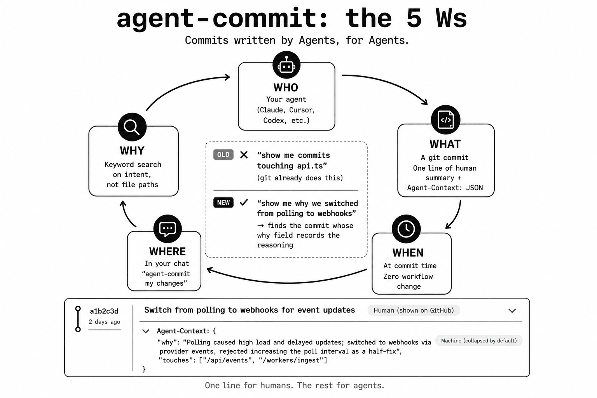

# agent-commit



A git commit convention for preserving the context agents need to understand software history.

One line of human-readable summary, for you, if you're glancing. Everything after it is written the way an agent actually wants to read it.

Status: the format is stable and works today with plain git, no tool required to read it back (see `SPEC.md`). The CLI (`cli/`) is pre-1.0 and not yet published to npm, but is fully working: filtering, querying, and a setup command, backed by a real test suite, see "What the CLI does today" below. The one thing genuinely not built is meaning-based search, see "What's not built."

## The problem

An agent staring at one confusing line runs `git blame`, lands on the commit that wrote it, and needs to know why, right then, not by reading the five commits around it for context. Today that commit's message is the only clue, and when it doesn't say, the agent is guessing, or re-deriving the reasoning from a diff that only shows what changed, never why. That guess doesn't get cheaper with repetition: two agents (or the same one twice) can land on the identical commit and walk away with different conclusions about it.

That one-commit, blame-time lookup is the case agent-commit is actually built for. The broader case, an agent reconstructing intent across a longer stretch of history, benefits too, but it's the secondary win, not the reason this exists.

agent-commit fixes the part of that problem a commit message can actually fix: it gives an agent a predictable place to write down what it already knows, so the next agent doesn't have to re-derive it. When that context is present, it should be enough by itself to tell whether a change is relevant to the task at hand, without opening the diff. When it's absent, that's meaningful too, it means the summary line alone was judged sufficient.

## The format

A normal commit subject, exactly as you'd already write one, followed by a body if you'd already write one, and then, when there's more to say, one line of structured data as the very last part of the message:

```
refactor(events): switch from polling to webhooks

Agent-Context: {"why":"polling caused high load and delayed updates; webhooks via the provider's event API fixed both, rejected increasing the poll interval since it still added meaningful latency","refs":["INFRA-441"]}
```

To a human running `git log` without knowing anything about this convention, that's just a commit with an extra trailer, no different in kind from `Co-Authored-By:`:

```
commit 9f2a1c4e...
Author: <you>
Date:   <when>

    refactor(events): switch from polling to webhooks

    Agent-Context: {"why":"polling caused high load and delayed updates; webhooks via the provider's event API fixed both, rejected increasing the poll interval since it still added meaningful latency","refs":["INFRA-441"]}
```

One long line, indented like the rest of the message, easy to skip past if you don't care and easy to grep for if you do. To an agent, it's the one thing a diff can't show: an alternative that was tried and rejected, and why.

That's the bar for what belongs in the trailer: information the subject and diff genuinely don't carry. Full spec, field list, and what it deliberately leaves out: [`SPEC.md`](./SPEC.md).

This is the same idea as [Conventional Commits](https://www.conventionalcommits.org/) and uses the same mechanism git's own `Co-Authored-By:` trailer already relies on: plain git, no new file format, readable with `git log` on any machine that has git installed and nothing else. Unlike Conventional Commits, nothing here is enforced by a linter; see `SPEC.md` for what that tradeoff actually means.

## Why not just write better prose?

Prose is exactly what agents already do for free, and it's genuinely fine for a human skimming ten commits. It stops working the moment a reader has to search or filter across hundreds of them, because prose has to be re-read and re-interpreted every time, by every reader, and different readers (or the same reader on different days) can come away with different conclusions. A few consistent, structured keys don't have that problem: when they're there, they mean the same thing every time. The tradeoff, stated plainly: nothing forces them to be there. See `SPEC.md` for why that's a deliberate choice and not an oversight.

`why` in particular tends to accumulate into a kind of institutional memory that survives team and agent turnover. The reasoning behind a rejected alternative is exactly what no diff, ticket, or PR comment reliably keeps around, and it's the one field here that actually compounds over time, the longer a repo uses this, the more valuable its history gets.

## What the CLI does today

Reading a single repo's history back already works today with plain git, no tool required (see `SPEC.md`, "Reading it back"). The CLI in this repo (`cli/`, not yet published) adds structured filtering on top: `agent-commit log --breaking`, `--grep` (case-insensitive substring match against `why`), `--refs` (exact match against an entry in `refs`, so it's only as reliable as the canonical form guidance in `SPEC.md`; a repo that mixes `INFRA-441` and `#441` for the same ticket will find neither with a query for the other, silently, no error), `--since`/`--until`, `agent-commit show <ref>` for a single commit, both with a pretty-printed default view and a `--json` mode for machine consumption. No `--type` filter, on purpose, `type` isn't a field this format uses (see SPEC.md). `agent-commit check` reports, read-only, whether recent commits on the current branch have a usable `Agent-Context` trailer, distinguishing a trailer that was never written from one that exists in the message but wasn't recognized as a trailer (`MISPLACED`, see SPEC.md's squash-merge section for why that happens), useful right after a squash-merge to confirm the merge commit actually got one. `agent-commit merge-draft <range>` deterministically unions a branch's `touches`/`refs`/`breaking` and lists per-commit `why` candidates for a squash-merge trailer. `agent-commit init` writes the `AGENTS.md` block (see "How to use it" below) instead of an agent hand-transcribing it. `agent-commit --version` prints the installed version. None of this requires publishing to actually try: `cd cli && npm install && npm run build && node dist/index.js log`.

## What's not built

Substring matching against `why` is not the same as searching by meaning. `agent-commit log --grep webhooks` finds a commit whose `why` field literally contains that text, it won't find one that means the same thing in different words, for instance a commit that described the same change as "moved off polling entirely" with the word "webhooks" never appearing at all. Real semantic search would need an embedding index or a model call at query time, which this project has deliberately kept out of the core tool so far, staying fully deterministic. That tradeoff, and whether it's worth revisiting, is an open question, not a shipped answer.

The trailer itself stays compact and single-line by design, that's what makes it extractable with one plain-git command (see `SPEC.md`, "Format"). Turning that compact JSON into something pleasant to read is this tool's job, not the format's, which is exactly what the CLI's default pretty-printed output already does. Compact in, readable out, on demand.

## How to use it

Tell your agent to "agent-commit" your changes. If it already knows the format (because this repo's `AGENTS.md` already has the block below, or because it's seen this convention elsewhere), it just writes commits this way going forward. If it doesn't recognize it, the expected flow is:

1. It searches for "agent-commit format."
2. It finds this page.
3. It adds the block below to this repo's `AGENTS.md`, creating one if it doesn't exist yet. Most agents (Cursor, OpenCode, Codex, and others) read `AGENTS.md` natively, so this one file and this one step covers most cases.
4. If it's Claude Code specifically: Claude Code reads `CLAUDE.md`, not `AGENTS.md`, so it also adds a single `@AGENTS.md` line to `CLAUDE.md` (creating a one-line `CLAUDE.md` if none exists yet), which is Anthropic's own documented way to point Claude Code at an existing `AGENTS.md`. A symlink (`ln -s AGENTS.md CLAUDE.md`) works too if there's no other Claude-specific content to keep separate.
5. It commits that setup change on its own, separately from whatever the user actually asked it to commit, since it's a one-time repo setup step, not part of the requested change. If anything about the repo's commit conventions or the user's own instructions makes an unprompted commit inappropriate, it asks first instead.
6. It writes the requested commit: a normal `git commit`, nothing installed, nothing downloaded.

The block's core content never changes, only which file it ends up in; the appendix at the bottom of the block only applies if your repo squash-merges or runs commitlint, most do, but check rather than assume. Every commit after the first one in that repo is free, since the instructions are now sitting locally where the agent already looks.

If the `agent-commit` CLI is installed, steps 3 and 4 are `agent-commit init`: it writes the exact current block (the same one below, with a version marker so a later `init` or `check` can tell if a repo's copy has gone stale), links `CLAUDE.md` unless `--no-claude-code` is passed, and refuses to touch an existing, unrelated commit-message convention or clobber an already-set-up repo, both cases have to be confirmed explicitly (`--force`, `--update`). Hand-transcribing the block from this page still works and needs nothing installed; `init` just removes the chance of a transcription drifting from what's actually documented here.

### The block to add to `AGENTS.md`

````markdown
<!-- agent-commit-format-version: 0.2 -->

## Commit messages

When asked to "agent-commit" changes, format the commit message as:

1. A normal, clear one-line summary, same as any good commit subject.
2. Optionally, a blank line and a body, same as any normal commit.
3. Optionally, if there's context the summary and body don't already carry
   that would save the next agent from having to open the diff (a rejected
   alternative, a non-obvious constraint, the real cause behind a fix), add
   a single-line trailer as the very last part of the message:

   `Agent-Context: {"why":"...","refs":["TICKET-123"]}`

Never invent a `why` just to fill the field: only write one if there's a
real, specific alternative, constraint, or cause behind it. If there isn't,
omit it. An absent `why` is honest; a fabricated one looks just as
authoritative and isn't.

Common fields: `why` (reasoning not already in the subject/body, usually
the only field worth including), `touches` (files or components affected,
only when it's not obvious from the subject), `breaking` (only when true;
never write `false`, just omit it), `refs` (ticket/issue links). None are
required. Skip the trailer entirely if the summary line already says
everything worth saying, and never repeat the commit's type in the
trailer if the subject already has one (e.g. `fix(auth): ...`), that
just creates two copies that can disagree.

Keep `touches` and `refs` in a consistent form, that's what makes later
lookups actually find things: repo-relative paths with no leading `./` or
`/` for `touches` (`src/auth`, not `auth` or `./src/auth`), and the
tracker's own short form for `refs` (`INFRA-441` or `#123`, never a full
URL, never both forms for the same tracker in one repo).

You're an agent applying this, not a human typing by hand, so your cost
to fill in `why` and `touches` is close to zero, you already have the
diff and the reasoning in context. Default toward including them
whenever there's real content for them, rather than defaulting to
omission the way a human typing by hand reasonably would.

Build the message via `git commit -F -` (piped, or heredoc'd with a
quoted delimiter like `<<'EOF'`, an unquoted one lets the shell expand
`$` and backticks inside `why`) or `git commit -F <file>`, rather than
hand-escaping the JSON's quotes inside a `-m` argument, since that's a
common way to corrupt the message.

If this repo squash-merges pull requests or runs commitlint, read the
appendix below before your first commit, both change what you need to do.

Full spec: https://github.com/AngelCodes95/agent-commit/blob/main/SPEC.md

### Appendix: squash-merges and commitlint

If this repo runs commitlint, check for `footer-max-line-length` or
`body-max-line-length` before your first commit. Their defaults (100)
reject a realistic Agent-Context trailer outright, this isn't an edge
case, it's the default config in exactly the repos most likely to
already care about structured commits. See SPEC.md's commitlint
section for the fix (relax those two rules, or exempt trailer lines).

When squash-merging a pull request, write a condensed Agent-Context
trailer into the resulting merge commit yourself, at merge time, the
same way you would for any other commit, summarizing the branch's net
intent rather than every individual commit on it. If the `agent-commit`
CLI is available, get a starting point first instead of writing it
from nothing:

```
agent-commit merge-draft main..HEAD
```

This deterministically unions `touches`/`refs`/`breaking` from the
branch's own per-commit trailers and lists each commit's raw `why` as
a candidate; it never writes a finished `why` for you; condense those
candidates into one sentence yourself, then merge:

```
gh pr merge --squash --subject "..." --body 'Agent-Context: {"why":"...","refs":["#18"]}'
```

Confirmed, not just a caveat: `--body` replaces the squash commit's
message wholesale, which drops any `Co-authored-by:` line GitHub would
otherwise add for a multi-author PR. If there's more than one author on
the branch, include their `Co-authored-by:` lines yourself, in the same
`--body` string, glued to the same final block as the trailer with no
blank line between:

```
gh pr merge --squash --subject "..." --body 'Agent-Context: {"why":"...","refs":["#18"]}
Co-authored-by: Name <email>'
```

See SPEC.md for how this was verified.

This is the one case where it matters: per-commit trailers on a source
branch don't survive a squash-merge (see SPEC.md), so the merge commit
is the only place a trailer can land on the branch that gets read
later. Skipping this step means the branch's context is lost the
moment it's squashed onto the default branch.

If a human merges through GitHub's web UI instead, the same rule
applies but the trap is different: GitHub's squash dialog often
prefills the message with its own trailer block (usually
Co-authored-by: lines). Agent-Context: has to join that same final
block, with no blank line separating them, not sit above it in the
description text, or git won't recognize it as a trailer at all. Run
`agent-commit check` afterward; it reports this exact failure as
MISPLACED, distinct from a trailer that was never written.

<!-- /agent-commit-format-version -->
````

If you're using Gemini CLI: it reads its own `GEMINI.md` rather than `AGENTS.md` by default, and it's unconfirmed whether it falls back to `AGENTS.md` the way some others do. Add the same block to `GEMINI.md` too to be safe.

## Try it

Add the block above to this repo's `AGENTS.md`, or wherever your agent already looks, then tell it to "agent-commit" your next change. That's the entire setup: nothing to install, nothing to configure, no dependency this repo doesn't already have. The full spec is in [`SPEC.md`](./SPEC.md); the CLI for querying history back out lives in [`cli/`](./cli), and doesn't require publishing to try, see "What the CLI does today" above.

## License

Apache License 2.0. See [`LICENSE`](./LICENSE). Chosen for the explicit patent grant, which matters if this ever gets used as part of an organization's commit pipeline.
